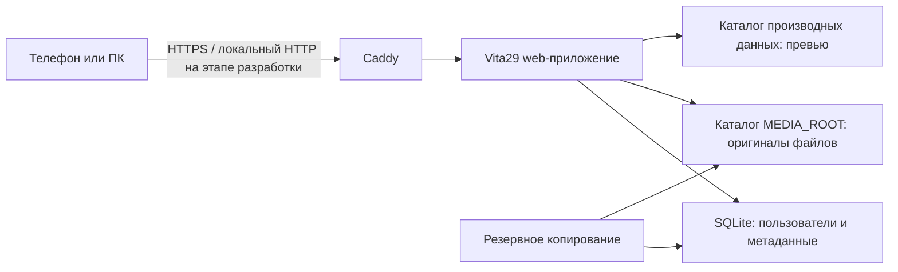

# Архитектура v1

Статус: принято как основа для реализации каркаса. Дата: 2026-08-14.

## 1. Границы первой версии

Первая полезная версия должна позволять:

- администратору создавать, отключать и сбрасывать пароль сотрудников;
- сотруднику входить под своей учётной записью;
- всем сотрудникам открывать рабочие папки друг друга;
- создавать отдельные приватные папки с доступом только для явно выбранных участников;
- загружать файл в папку любого активного сотрудника;
- загружать несколько фото и видео из галереи телефона или компьютера;
- предлагать запуск камеры через стандартный файловый элемент браузера там, где это поддерживает мобильная ОС;
- просматривать галерею, открывать превью, скачивать и делиться доступными файлами;
- работать в локальной сети и быть готовой к безопасной публикации через домен.

Не входят в первую версию: синхронизация как у облачного диска, редактирование медиа, распознавание лиц, публичные ссылки, Telegram/Instagram/MAX API, мобильные приложения и сложные роли. Передачу файла в установленные приложения позднее реализуем через системное меню «Поделиться» (Web Share API), когда браузер это поддерживает.

## 2. Компоненты



### Приложение

- Backend: Python 3.12+, FastAPI, SQLAlchemy 2, Alembic. Рабочий контейнер использует Python 3.13.
- Frontend: React, TypeScript, Vite; после сборки обслуживается backend как статические файлы.
- Один процесс приложения и один reverse proxy. Отдельные Redis, PostgreSQL и очередь задач для v1 не нужны.
- Приложение запускается контейнером с ограниченными правами. Caddy завершает HTTPS и проксирует запросы.

Такой стек достаточно лёгок для Raspberry Pi 4 и остаётся простым для сопровождения. SQLite подходит для небольшого числа сотрудников и умеренного количества одновременных операций; файлы в базу не помещаются.

## 3. Хранение и будущий HDD

Приложение знает только логический путь `MEDIA_ROOT`, переданный настройкой окружения. В контейнере это всегда `/data/media`, независимо от физического носителя.

Начальная схема:

```text
/srv/vita29/
├── app-data/          # SQLite и служебные данные
├── media/             # временно на microSD
│   ├── originals/
│   └── previews/
└── backups/
```

После установки HDD каталог диска монтируется хостом в `/srv/vita29/media`. Путь внутри приложения не меняется. Миграция состоит из остановки приложения, копирования данных с проверкой, изменения системной точки монтирования и повторного запуска.

Файлы хранятся не под исходным именем, а под сгенерированным UUID. Исходное имя и MIME-тип находятся в SQLite. Новые файлы размещаются по пространству и дате, например `originals/<workspace-id>/2026/08/<uuid>`. Это исключает коллизии имён и не позволяет имени от пользователя влиять на путь. Старые физические пути не перемещаются: их пространство задаётся в базе.

## 4. Модель данных

- `users`: id, имя, логин, хэш пароля, роль `owner|admin|employee`, статус, даты создания и изменения. Единственный владелец системы защищён от управления администраторами студии.
- `workspaces`: обычные папки `studio`, доступные команде, и приватные `private` с владельцем.
- `workspace_members`: явный список участников приватной папки.
- `media_files`: id, workspace_id, owner_id, uploaded_by_id, storage_key, original_name, media_type, mime_type, size_bytes, checksum_sha256, created_at, deleted_at. `uploaded_by_id` сохраняет фактического загрузившего.
- `sessions`: серверные сессии с датой истечения и возможностью отзыва.
- `audit_log`: входы, загрузки, скачивания, удаления и административные изменения.

Удаление сначала мягкое: запись получает `deleted_at`, файл перемещается в служебную корзину. Окончательная очистка выполняется по отдельной политике, которую согласуем перед включением.

## 5. Загрузка файлов

- Потоковая запись на диск без загрузки всего видео в оперативную память.
- Временный файл создаётся в том же файловом разделе, затем атомарно переименовывается.
- Проверяются допустимый тип, фактическая сигнатура, размер и свободное место.
- Для каждой загрузки считается SHA-256.
- Лимиты размера и общий резерв свободного места задаются настройками.
- Превью создаётся после сохранения оригинала; сбой превью не уничтожает оригинал.

Интерфейс использует стандартный `input type=file` с `multiple` и `accept=image/*,video/*`. Отдельная кнопка камеры использует `capture=environment`; фактическое поведение зависит от iOS/Android и браузера.

## 6. Доступ и безопасность

- Пароли хэшируются Argon2id.
- Авторизация хранится в серверной сессии; cookie имеет `HttpOnly`, `Secure` и `SameSite=Lax`.
- Любой вошедший сотрудник может читать и скачивать файлы обычных рабочих папок. Приватную папку и каждый её файл видят только её владелец и явно добавленные участники; проверка выполняется сервером и для прямых URL. Удалять доступный файл может владелец папки, фактический загрузивший, администратор или владелец системы. Реальный путь никогда не принимается из URL напрямую.
- Изменяющие запросы защищаются от CSRF; вход ограничивается по частоте.
- Секреты находятся только в локальном `.env`, который не попадает в Git.
- Контейнер приложения работает не от root и получает запись только в каталоги данных.
- SSH и админская веб-функциональность не публикуются без необходимости.

Для внешнего доступа нужен только HTTPS. Предпочтительный вариант будет выбран на отдельном этапе после проверки домена и роутера:

1. Cloudflare Tunnel — без входящего порта на роутере, но с зависимостью от Cloudflare.
2. Прямой Caddy на порту 443 — меньше внешних зависимостей, но требует белого IP/корректного DNS и аккуратной настройки роутера.

Публикация в интернет не выполняется до проверки обновлений, резервного копирования, восстановления и ограничений входа.

## 7. Развёртывание и эксплуатация

- Docker Compose описывает `app` и `caddy`; архитектура ARM64 поддерживается сборкой образа на Raspberry Pi.
- Конфигурация разделена на версионируемый пример и локальные секреты.
- Alembic выполняет контролируемые миграции БД перед запуском новой версии.
- Healthcheck проверяет процесс, доступ к БД и каталогам данных.
- Логи пишутся в stdout/stderr и ограничиваются ротацией Docker.
- Резервная копия включает SQLite и оригиналы. Копия на том же HDD не считается полноценной резервной копией.

## 8. Принятые ограничения

- Один Raspberry Pi — одна точка отказа.
- SQLite рассчитана на этот небольшой сервер, а не на высокую параллельную нагрузку.
- microSD — временное хранилище; до HDD вводится консервативный лимит свободного места.
- RAID не заменяет резервную копию; вопрос второго носителя/внешней копии решается отдельно.
- Web-интерфейс не может гарантированно отправить файл напрямую в конкретный сторонний сервис: это контролируют ОС и установленные приложения.

## 9. Решения, отложенные до соответствующего этапа

- домен и способ внешней публикации;
- точный максимальный размер одного файла и квота сотрудника;
- срок хранения корзины;
- место второй резервной копии;
- нужны ли папки/альбомы поверх пространства сотрудника.
